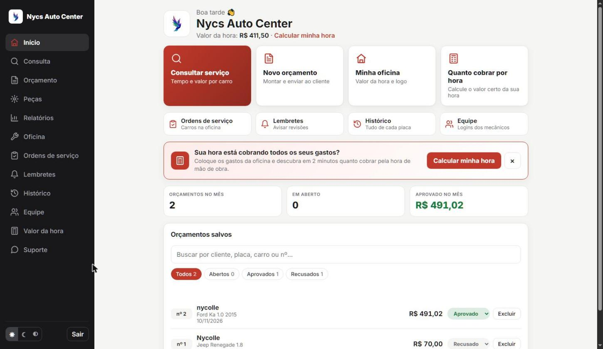
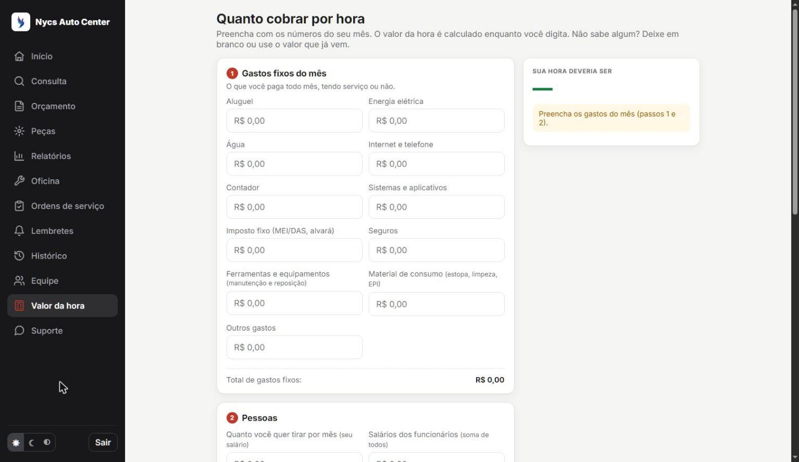

### Oi, eu sou a Nycolle 👋

Desenvolvedora Web em formação, em Rio Grande (RS). Depois de mais de 6 anos atendendo clientes no setor automotivo e no varejo, hoje uso esse olhar para criar sistemas que resolvem problemas reais de quem usa — vários deles já em uso no dia a dia de uma oficina.

**Tecnologias:** HTML • CSS • JavaScript • React • Java • SQL • Supabase • Git/GitHub

**Também estudo:** Node.js, UX, Scrum, levantamento de requisitos e UML

### Projetos em destaque

- **Tabela de Mão de Obra** (SaaS): tempo e valor de cada serviço por carro, com login por oficina, valor-hora próprio e orçamento direto no WhatsApp. HTML, CSS, JS + Supabase · [ver online](https://tabela-mao-de-obra.pages.dev)

  

    
    
    
    
  

- [AutoCheck Manager](https://github.com/NycolleF/auto-check-system): gestão de oficina (clientes, veículos e OS) · [testar online](https://nycollef.github.io/auto-check-system/)
- [AutoDiagnóstico](https://github.com/NycolleF/Autodiagnostico): diagnóstico automotivo por sintoma · [testar online](https://nycollef.github.io/Autodiagnostico/)
- [Smart Garage Simulator](https://github.com/NycolleF/Smart-garage-simulator): triagem de atendimento em oficina · [testar online](https://nycollef.github.io/Smart-garage-simulator/)
- [Calculadora de Peças](https://github.com/NycolleF/calculadora-pecas): orçamento de peças comparando fornecedores e frete · [testar online](https://nycollef.github.io/calculadora-pecas/)
- [Evoluta](https://github.com/NycolleF/Evoluta-saas): SaaS de mentorias (Java + Spring Boot + React)

### Certificações

Engenharia de Software, UX e Big Data (FIAP) • Scrum e Projeto de Sistemas Web (IFRS)

📚 **Em andamento:** trilha de desenvolvimento web do IFRS — HTML5, CSS3, JavaScript, React e Node.js

💼 [LinkedIn](https://www.linkedin.com/in/nycolle-fiussen-6b8673174)
