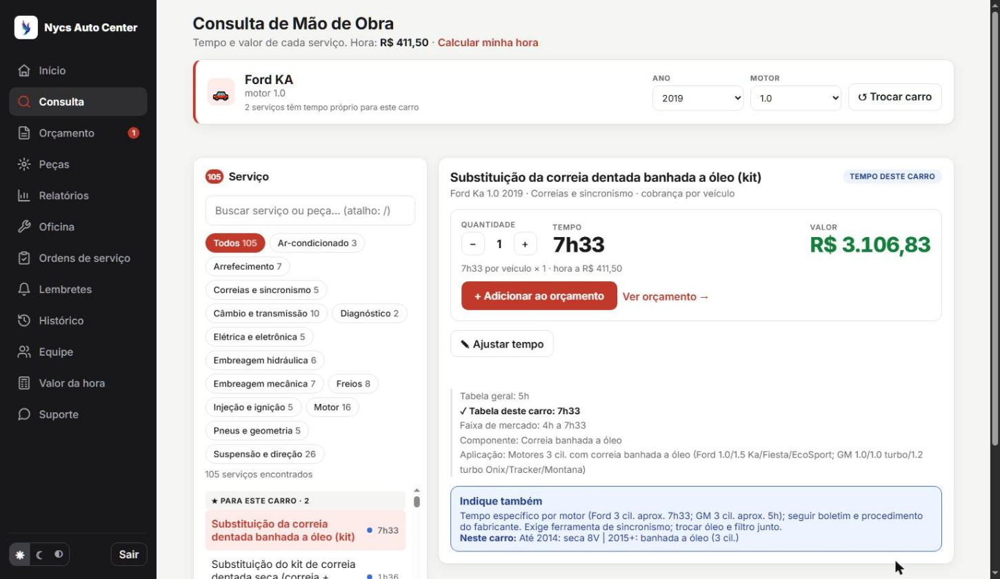
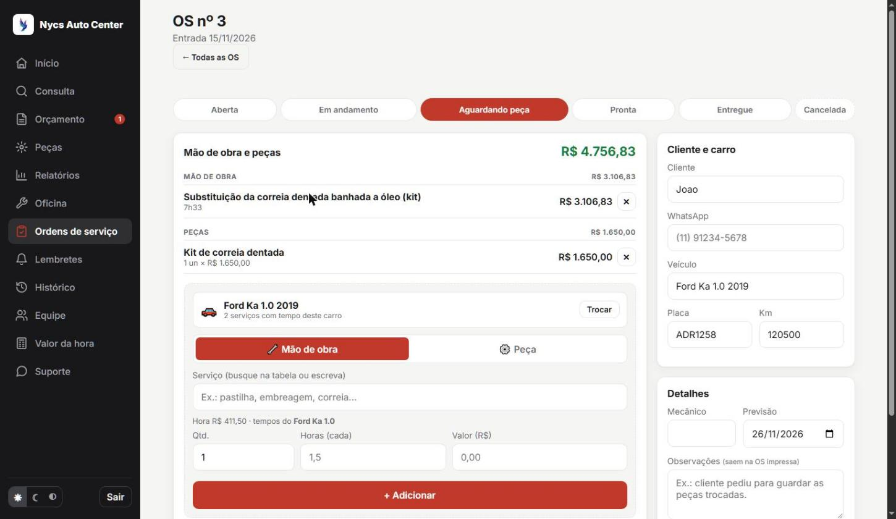

### Oi, eu sou a Nycolle 👋

Estou estudando desenvolvimento web e moro em Rio Grande (RS). Trabalho há mais de 6 anos com atendimento, no setor automotivo e no varejo. Hoje crio sistemas pensando nos problemas que vejo no atendimento da oficina.

**Tecnologias:** HTML, CSS, JavaScript, React, Java, SQL, Supabase e Git

**Estudando:** Node.js, UX, Scrum, requisitos e UML

### Projetos

- **Tabela de Mão de Obra**: a oficina escolhe o carro, vê o tempo e o valor de cada serviço e manda o orçamento pelo WhatsApp. Cada oficina tem seu login e seu valor da hora. Feito com HTML, CSS, JavaScript e Supabase. [Ver online](https://tabela-mao-de-obra.pages.dev)

  

    
    
    
    
  

- [AutoCheck Manager](https://github.com/NycolleF/auto-check-system): cadastro de clientes, veículos e ordens de serviço. [Testar](https://nycollef.github.io/auto-check-system/)
- [AutoDiagnóstico](https://github.com/NycolleF/Autodiagnostico): mostra o possível problema do carro a partir do sintoma. [Testar](https://nycollef.github.io/Autodiagnostico/)
- [Smart Garage Simulator](https://github.com/NycolleF/Smart-garage-simulator): triagem de atendimento na oficina. [Testar](https://nycollef.github.io/Smart-garage-simulator/)
- [Calculadora de Peças](https://github.com/NycolleF/calculadora-pecas): compara o preço das peças entre fornecedores, com frete. [Testar](https://nycollef.github.io/calculadora-pecas/)
- [Evoluta](https://github.com/NycolleF/Evoluta-saas): sistema de mentorias com Java, Spring Boot e React.

### Cursos

- FIAP: Engenharia de Software, UX e Big Data
- IFRS: Scrum e Projeto de Sistemas Web
- Fazendo agora: trilha de desenvolvimento web do IFRS (HTML, CSS, JavaScript, React e Node.js)

[LinkedIn](https://www.linkedin.com/in/nycolle-fiussen-6b8673174)
